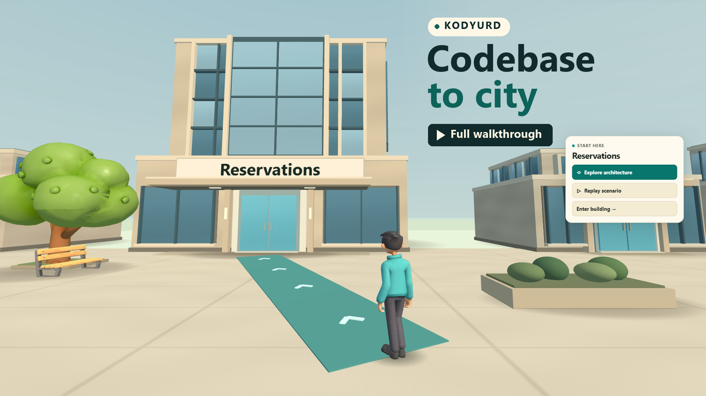

# Kodyurd

Kodyurd turns a local workspace into a walkable 3D city. Explore modules, inspect architecture and data relationships, replay evidenced behavior, read linked documents, and practice what you learned.

[Download the walkthrough (MP4, 4:17)](https://github.com/azerturk/kodyurd/releases/download/v0.6.0/Kodyurd-Walkthrough-EN.mp4)

Walkthrough narration generated with [ElevenLabs](https://elevenlabs.io/).

## Run from source

Install Node.js 22.13 or newer. In a clone of this repository, run:

~~~sh
npm ci
npm run build
npm start
~~~

Open `http://127.0.0.1:4717` if the browser does not open automatically. Generation uses your existing Claude Code or Codex CLI login, or your Anthropic API key. Choose a provider in **Settings**. Kodyurd stores workspace data under `~/.kodyurd` and serves the app from your computer.

**The 85 bundled GLBs are in `packages/assets/models/`.** The app loads them locally and shows the opening view when its models are ready. Add your own Tripo API key in **Settings** if you want to generate a personal model. [Model guide](docs/ASSETS.md)

## Try Harbor Desk

Harbor Desk is the included example workspace. It models office reservations and asynchronous notifications. Select **Add workspace**, enter the full path to `examples/harbor-desk`, then generate a city with the [example brief](docs/USAGE.md#harbor-desk-walkthrough). The sample service can also run on its own. [Harbor Desk source and instructions](examples/harbor-desk/README.md)

## Explore and share

- **Explore architecture** opens the focused module's diagram. **Diagrams** lists component, behavior and data views that are available for this city.
- **Replay scenario** opens the playable examples supported by source evidence. **Learn** contains tours, practice and exams.
- **Docs** and diagram evidence open excerpts in the city or at a validated line in your editor.
- **Export bundle** saves a static ZIP with the models used by the city. A static HTTP server can serve the extracted city. Review the scene text and model rights before sharing.

Kodyurd scans your files locally. Generation and Guide Q&A send bounded workspace excerpts to your selected provider. [Workspace guide](docs/USAGE.md) · [Privacy and network activity](docs/PRIVACY.md)

## Tech stack

- **Language:** TypeScript
- **Frontend:** React, Tailwind CSS, and Vite
- **3D rendering:** PlayCanvas with bundled GLB models
- **Local server and CLI:** Node.js, with Fastify for the HTTP API
- **Local storage:** SQLite via `node:sqlite`
- **Scene validation:** Zod schemas for Scene JSON
- **AI integrations:** Claude Code, Codex CLI, or the Anthropic API for city generation and workspace Q&A
- **Optional 3D generation:** Tripo API for custom model overlays
- **Project tooling:** npm workspaces

## Roadmap

Kodyurd is in early development. The first public release focused on getting the core workflow working end to end, from scanning a repository to exploring it as a 3D city.

- **Create cities from GitHub repositories.** Review the local scan and choose a provider before generating.
- **Refine the architecture** by clarifying how the UI, 3D engine, and server interact.
- **Improve the codebase** with a focus on code quality, consistency, and making it easier to maintain and extend.
- **Expand what Kodyurd can do** by adding new ways to explore and understand repositories and improving the experience of using the tool.

### Ideas to explore

- **Compare repository revisions** by highlighting changes to modules and their relationships in the city.
- **Build and share custom tours** by choosing stops and adding notes for onboarding or architecture reviews.
- **Jump from the editor to the city** by opening the module or lesson related to the file you are editing.

## Contribute

Fork or clone the repository to develop the application. Run `npm run doctor` for environment checks and `npm run build` followed by `npm test` to check changes. [Architecture overview](docs/ARCHITECTURE.md) · [Contributing](CONTRIBUTING.md) · [Security reporting](SECURITY.md)

The source code is licensed under [MIT](LICENSE). See the [model pack notice](packages/assets/README.md) for the bundled assets.
