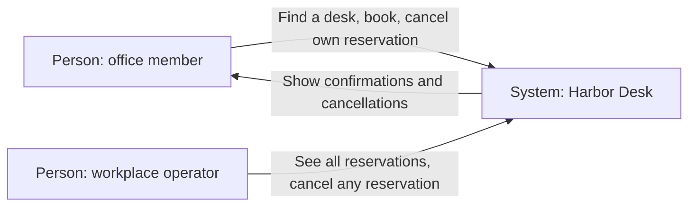
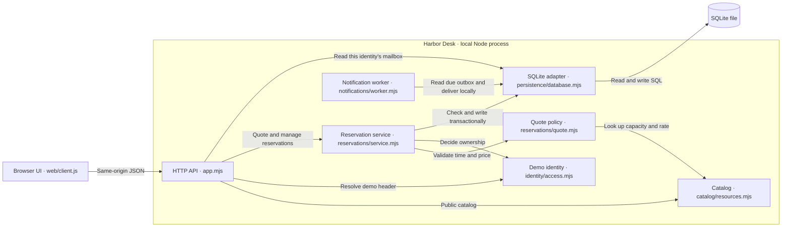
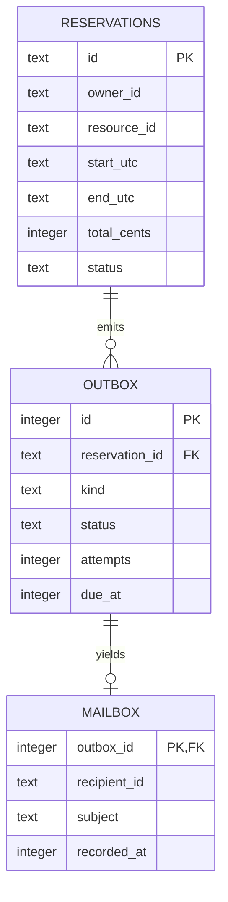

# Harbor Desk architecture

The browser sends same-origin requests to the local Node process. SQLite holds reservation and mailbox data. The demo runs on one computer and has no external mail or identity service.

## System context

## Containers and components

The process entry point in [server.mjs](../server.mjs) wires the API, SQLite adapter, and notification worker. The server listens on loopback and starts the worker's poll timer after listening. The browser reads its mailbox on demand. A confirmation does not imply that its notification has been delivered.

## Data relations

The [SQLite schema](../persistence/schema.mjs) limits a reservation to one event of each kind. A mailbox row belongs to exactly one outbox row. Owner and resource identifiers refer to the demo fixtures in [identity/access.mjs](../identity/access.mjs) and [catalog/resources.mjs](../catalog/resources.mjs).
