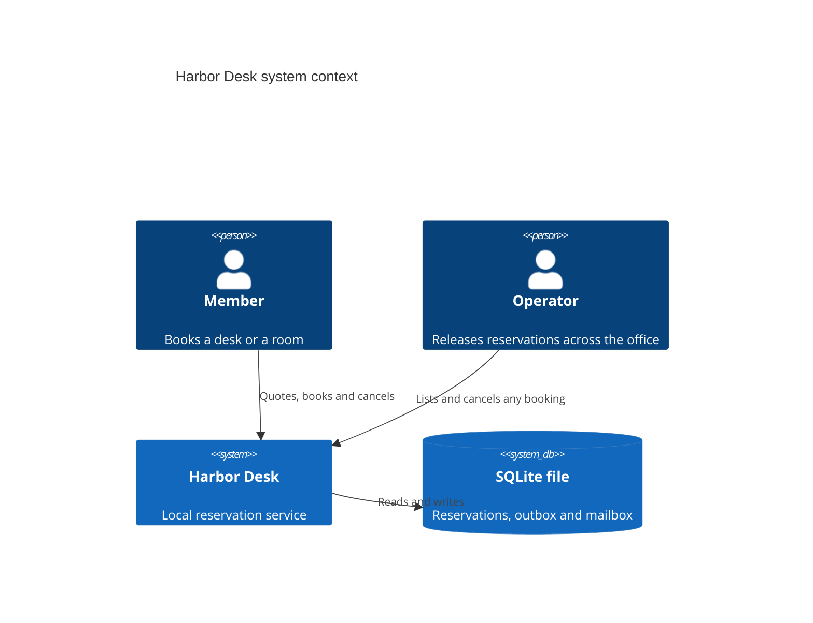
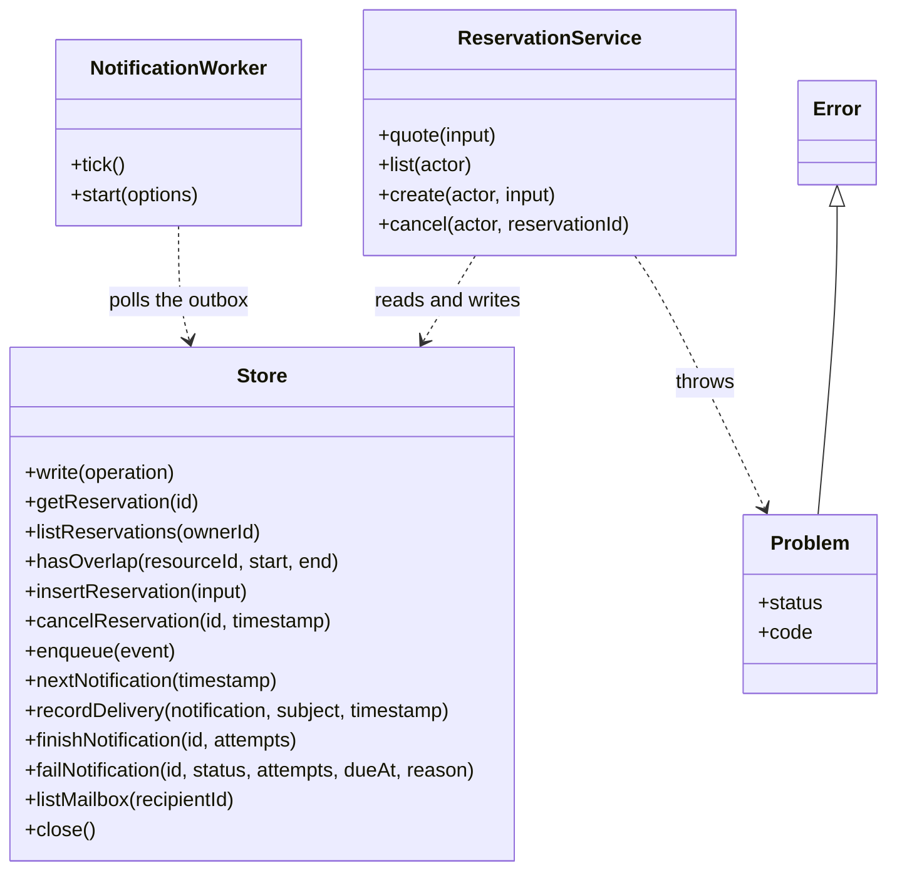
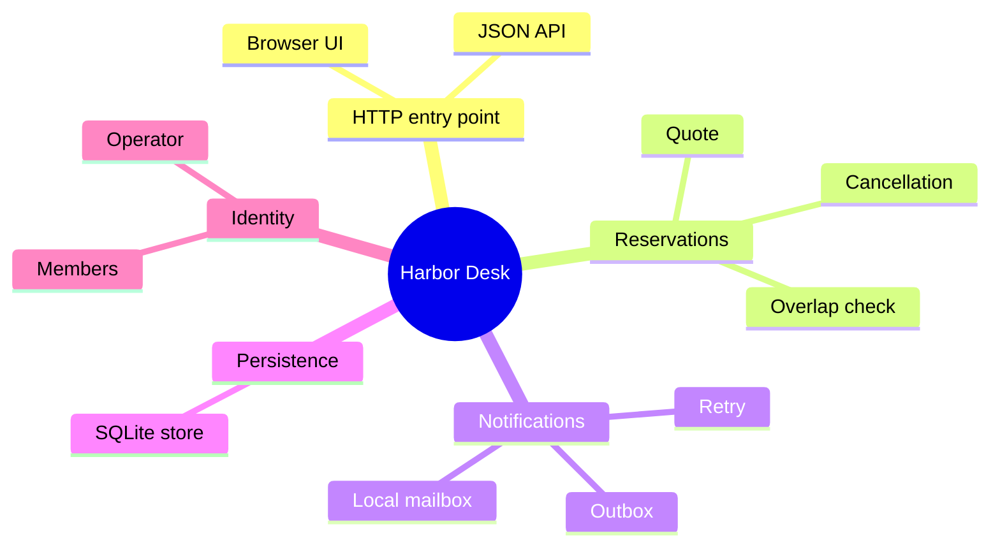

# Code map

Harbor Desk has no framework. Three factory functions return the objects that do the work, and one error class carries every rejected request. [Architecture](architecture.md) shows the same parts as containers.

## System context

## Service objects

[createReservationService](../reservations/service.mjs), [openStore](../persistence/database.mjs) and [createNotificationWorker](../notifications/worker.mjs) return these objects. [Problem](../reservations/problem.mjs) is the only class.

## Topics

