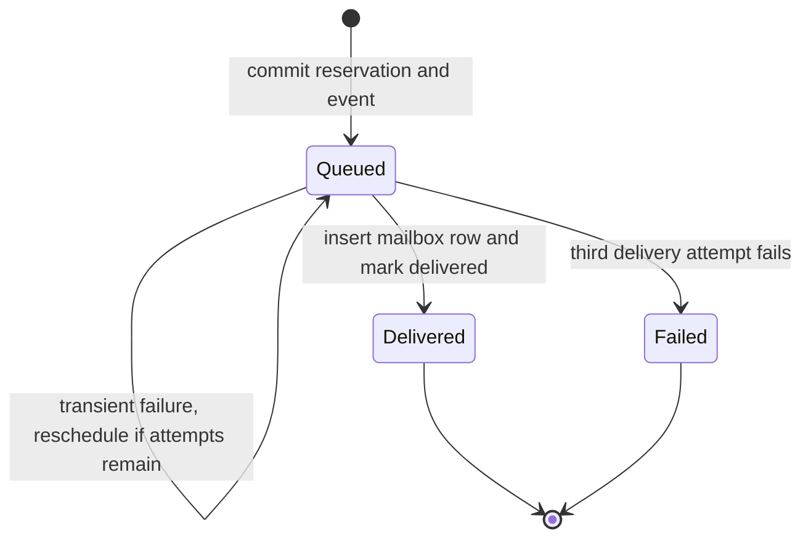

# Notification lifecycle

Booking and cancellation add a durable outbox row. The [notification worker](../notifications/worker.mjs) polls for due rows and handles one row per tick. Delivery records a local mailbox message and marks the outbox row delivered in one SQLite transaction. The worker does not send real email.

| Attempt | Simulated failure | Success |
| --- | --- | --- |
| 1 | Remains queued. Earliest retry is 1 second later | Delivered |
| 2 | Remains queued. Earliest retry is 2 seconds later | Delivered |
| 3 | Marked failed with no further attempts | Delivered |

The app can force every message's first attempt to fail by setting `HARBOR_DEMO_NOTIFY_FAIL_ONCE=1` before startup. The [worker tests](../notifications/worker.test.mjs) exercise successful retry and exhaustion with a controlled clock. The [database tests](../persistence/database.test.mjs) reopen a file to verify retry continuity after shutdown.

The reservation outcome stays confirmed or cancelled independent of notification delivery. Refresh the local mailbox under the recipient's identity to see delivered updates.
