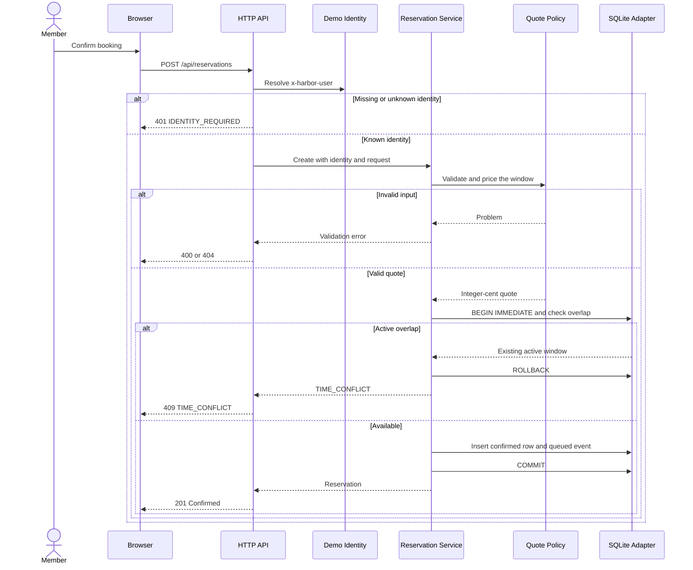
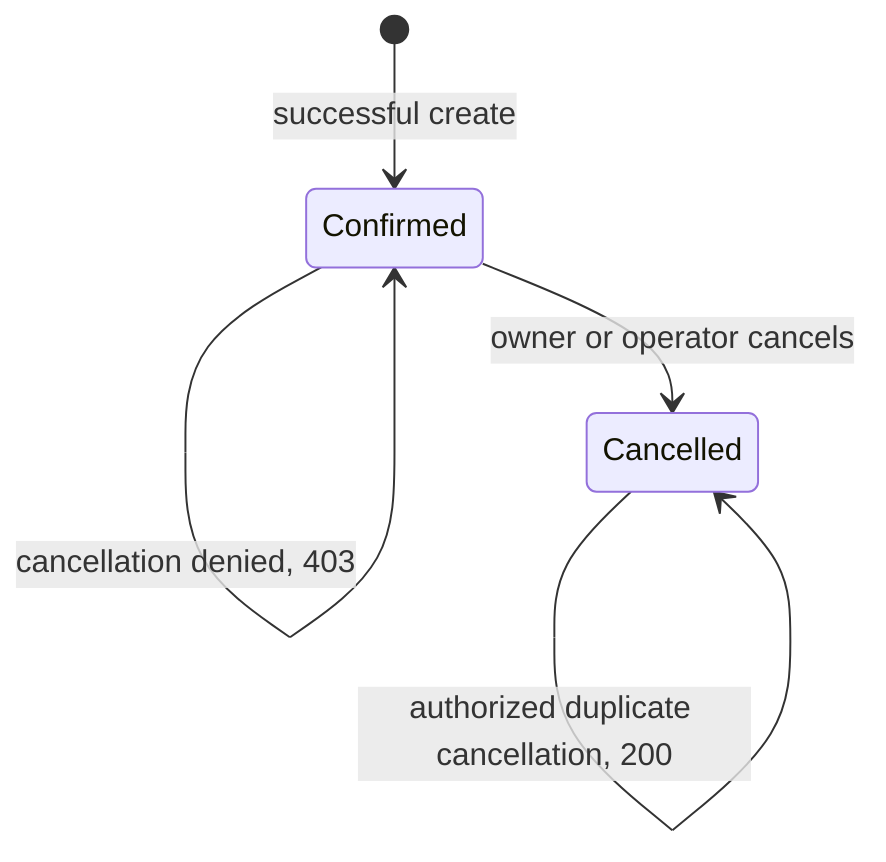

# Reservation lifecycle

One reservation holds the entire desk or room for a half-open window, `[start, end)`. The end of one confirmed reservation can be the start of another on the same resource.

## Booking sequence

[The reservation service](../reservations/service.mjs) checks overlap and enqueues confirmation inside the same transaction. The [SQLite adapter](../persistence/database.mjs) checks overlap only against confirmed reservations.

## Quote rules

| Condition | Result |
| --- | --- |
| Resource ID is outside the catalog | `404 RESOURCE_UNKNOWN` |
| Attendee count is not an integer between 1 and resource capacity | `400 INVALID_CAPACITY` |
| Window crosses a UTC date, lies outside 09:00–18:00, is off the half-hour grid, or lasts outside 30 minutes–4 hours | `400 INVALID_WINDOW` |
| Room spans at least four slots | Apply a 10% discount rounded down to integer cents |
| Other valid quote | Charge the full per-slot rate |

Public quotes estimate price independently of availability. Confirmation recalculates the quote on the server and checks for conflicts. See [quote.mjs](../reservations/quote.mjs).

## Cancellation state

The actor must be the owner or an operator even when the reservation is already cancelled. On the first successful cancellation, the window becomes available and an outbox event is added. A denied attempt changes no data. [Reservation service](../reservations/service.mjs) · [Access policy](../identity/access.mjs)
