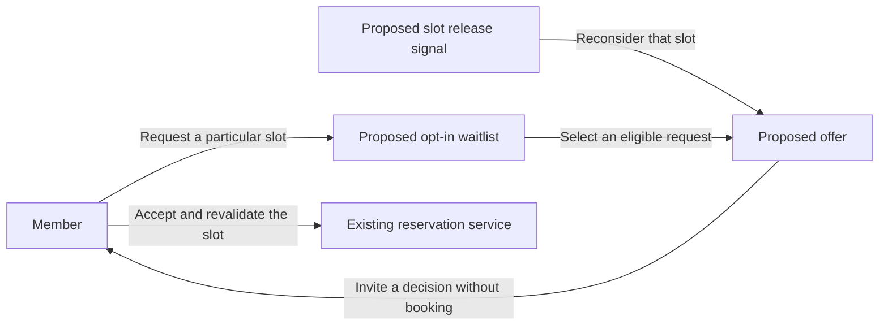

# Reservation waitlist proposal

**Status** Proposed. This is a design-only extension. Harbor Desk currently has no waitlist, offer records, offer expiry, or waitlist endpoint.

## System context

A member who cannot reserve a particular room and time could request an offer if that slot is released. The proposal covers only the path from a release to an offer and the member's decision to accept it. The existing reservation flow would still confirm or reject an attempted booking.

## Proposed outcome

An offer gives the member a choice without changing the reservation. Acceptance would use the current booking checks, including capacity, slot validity, and overlap. If the slot is already taken, acceptance would fail through the normal conflict path. A member could decline or let the offer expire without creating a booking.

Read [the offer decision](adr-002-offer-without-auto-booking.md#decision) for its rationale and [the existing reservation rules](../docs/reservations.md) for the current booking boundary.
